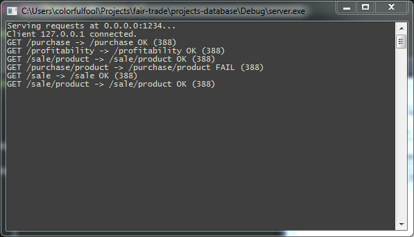
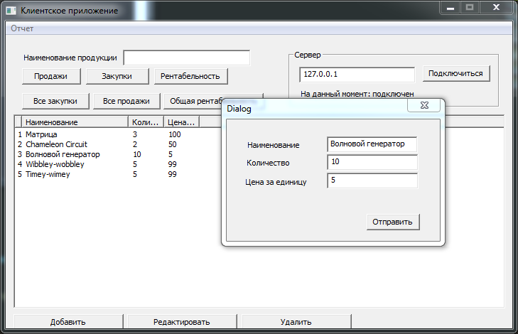
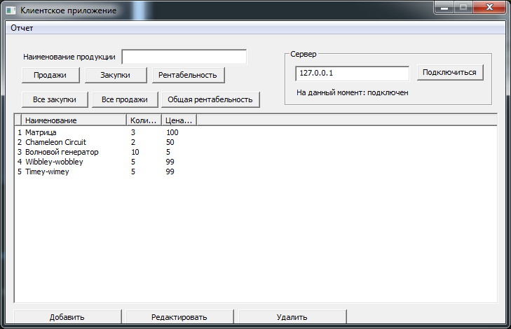
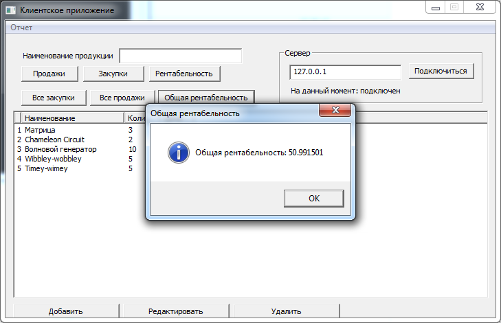
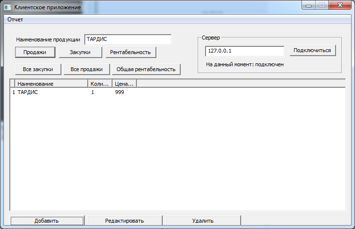

Для начала нужно установить MySQL и драйвер к ней, они в папке setup. 

MySQL после установки предложит себя настроить: characher set нужен utf-8 (ибо в задании требовали русский язык), root password - "password", все остальное по-умолчанию.

Там же есть скрипт create-and-populate.sql, который создает таблицы в базе и добавляет в них немного записей. Для его исполнения можно воспользоваться скриптом execute-sql.bat, а можно и прямо из консоли:

    "C:\Program Files\MySQL\MySQL Server 5.5\bin\mysql.exe" --user=root --password=password < setup\create-and-populate.sql

---

Сервер и клиент лежат в /projects-database/Debug/.

Если запустить серверную часть с соответствующим агрументом, она создаст нужные таблицы в базе:

    server.exe --create-database

---

Сервер принимает запросы клиентов и пишет в консоль результат их обработки:

Главное окно клиента со списком продукции и отчётом:

Диалог добавления новой записи:

Расчёт общей рентабельности:

Поиск продукции по наименованию:

